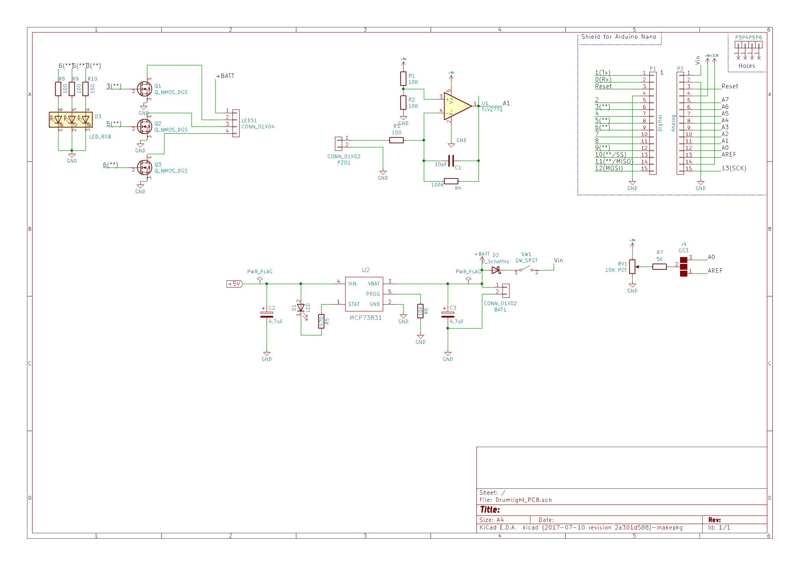

# DrumLights

Piezo-sensitive LED control for Samba drumming. A small, cheap Arduino Nano shield picks up the signal from a piezo disc on the drum and drives RGB LEDs through N-channel MOSFETs, so the drum lights up when it is hit.

This design was featured and used in the **Adelaide Fringe Festival parade**.

## Links

- Buy the board: [DrumLights on Tindie](https://www.tindie.com/products/whatnick/drumlights/)
- Build write-up: [Piezo Activated Drumlights on Hackster.io](https://www.hackster.io/whatnick/piezo-activated-drumlights-3be4e3)
- Videos of experiments: [whatnick on YouTube – DrumLights search](https://www.youtube.com/@whatnick/search?query=drum%20lights)
- Roadmap: [GitHub Project board](https://github.com/users/whatnick/projects/1/views/2) (Tindie product manager)

## How it works

1. A piezo disc is attached to the drum head or shell. A hit produces a voltage spike.
2. The spike is read on `A1` of the Arduino Nano (the piezo is loaded with a high-value resistor to keep the ADC input safe).
3. A 30-sample running average smooths the signal and rejects crosstalk; values above `noise_thresh` trigger the lights.
4. A potentiometer on `A0` sets how long the light stays on.
5. PWM pins `D3` (green), `D5` (red) and `D6` (blue) drive MOSFETs that switch the LED channels.

## Repository layout

| Path | Contents |
| --- | --- |
| `DrumLights/DrumLights.ino` | Arduino firmware (needs the [RunningAverage](http://playground.arduino.cc/Main/RunningAverage) library) |
| `Drumlight_PCB/` | KiCad 10 project for the Nano shield (schematic, PCB, footprints, 3D models) |



### Hardware status

- ERC and DRC (with schematic parity) pass with 0 violations in KiCad 10. Project rules in `Drumlight_PCB.kicad_pro` relax checks that are inherent to a Nano shield: the P3–P6 mounting pins sit on the board edge, and the Nano sockets overlap courtyards and silkscreen.
- Footprints live in the project library `Drumlight_PCB.pretty`.
- Q1–Q3 (BSS306N) use a custom `SOT-23` footprint whose pads are numbered D=1 (lone pad), G=2, S=3 to match the `Q_NMOS_DGS` symbol. This is not the JEDEC order (G1 S2 D3), but physically the drain pin lands on the drain net. Don't swap in a generic SOT-23 footprint without re-checking.
- `Drumlight_PCB/Drumlight_PCB_bom.csv` is the sourced BOM (manufacturer, MPN, LCSC and DigiKey/Mouser search links), exported from the schematic fields. Check live stock before ordering: D3 (`LRTB GFTM`) has no Mouser/DigiKey listing and RV1 has no LCSC part. See the cost-down table in `docs/SOURCING_AND_BUSINESS_CASE.md`. C2/C3 are now `CL10A475KO8NNNC`, SW1 is `CHS-01TB`, D2 is `B5819W SL`, U1 is `TLV9001IDBVR`, U2 is the 4.2 V `MCP73831T-2ACI/OT` (use `-3ACI` only for 4.35 V cells) and LEDS1 is the single-row `105313-1204`.

## Getting started

1. Install [`arduino-cli`](https://arduino.github.io/arduino-cli/) (or the Arduino IDE) and the `RunningAverage` library.
2. Build and upload:

   ```sh
   arduino-cli lib install RunningAverage
   arduino-cli core install arduino:avr
   arduino-cli compile -b arduino:avr:nano DrumLights
   arduino-cli upload  -b arduino:avr:nano -p <PORT> DrumLights
   ```

3. Fit the shield, connect the piezo, LED strip and a 5 V supply.
4. Tune `noise_thresh` and the delay pot for your drum.

The firmware is verified to compile with `arduino:avr` 1.8.8 (Nano) and `arduino:esp32` 2.0.18 (`arduino:esp32:nano_nora`).

See [docs/SOURCING_AND_BUSINESS_CASE.md](docs/SOURCING_AND_BUSINESS_CASE.md) for part sourcing, platform options (Nano, ESP32, STM32, RISC-V), BOM cost and pricing.

## Fleet control with ESP32-S3 (planned)

The shield uses the Arduino Nano footprint, so a Nano-format ESP32-S3 board can plug in to add wireless sync across many drums (ESP-NOW broadcast from a leader, or BLE/Wi-Fi). Candidates:

- [Arduino Nano ESP32](https://docs.arduino.cc/hardware/nano-esp32/) (ABX00083, ESP32-S3, u-blox NORA-W106) – exact Nano pinout, supported by the `arduino:esp32` core. Pins `A0`/`A1`/`D3`/`D5`/`D6` map as on the Nano; the firmware sets the ADC to 10-bit on ESP32 so thresholds carry over. Note it is a 3.3 V logic board (MOSFET gates still switch with these logic levels, but the 5 V pin and the on-board op-amp supply should be re-checked).
- Third-party "ESP32-S3-Nano" boards in the same footprint – check the pinout against the Arduino Nano ESP32 before use.
- Other ESP32 Nano-format boards (e.g. OLIMEX-style ESP32 Nano modules) – pinouts vary, so verify before use.

Progress is tracked in the issues on the project board.

## Similar open-source projects

- [Arduino Knock sensor example](https://docs.arduino.cc/built-in-examples/sensors/Knock/) – the basic piezo-to-Arduino reading used as a starting point.
- [Mike Barela / Adafruit piezo trigger tutorials](https://learn.adafruit.com/) – piezo and LED triggering with Adafruit boards.
- [Arduino Drum Trigger / Hi-Hat Controller – Arduino MIDI Drums (ATmega MIDI drum kits)](https://github.com/topics/arduino-drums) – open-source piezo drum triggers.
- [WLED](https://github.com/Aircoookie/WLED) – open-source LED controller that can be driven by audio/sensor input on ESP8266/ESP32.
- [Open Music Labs piezo drum trigger notes](https://www.openmusiclabs.com/) – conditioning piezo signals.

## Roadmap

Tracked as GitHub issues and on the [Tindie product manager project board](https://github.com/users/whatnick/projects/1/views/2). See the [issue list](https://github.com/whatnick/DrumLights/issues) for current status.

## License

See repository for license details.
